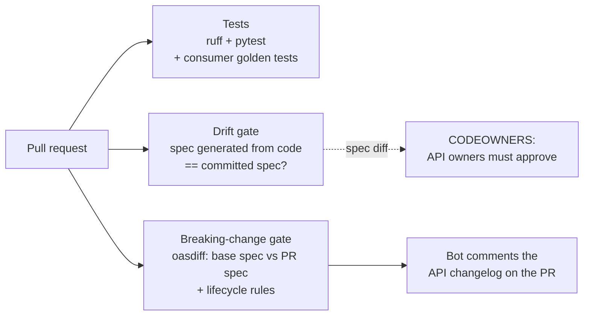

# API versioning demo: FastAPI + pydantic + CI enforcement

> **🏷️ You're on the `alt/tagged-handlers` branch.** It serves the *same* v1 and v2
> APIs as `main` (the generated specs are byte-for-byte identical), but every handler
> lives once in [`api/routes.py`](services/orders/src/orders/api/routes.py), tagged with
> the versions it serves, with an `if` where versions differ. The contracts stay one
> module per version. **Read [docs/tagged-handlers.md](docs/tagged-handlers.md)** for the
> walkthrough and trade-offs, and [PR #9](https://github.com/sspeaks/api-versioning-demo/pull/9)
> for what a breaking change (v3) looks like here. The demo PRs #1–#5 target `main`'s layout.

A small monorepo-shaped example of how to **stabilize public APIs** so external
consumers can rely on them while the code behind them keeps changing fast.

## The problem

We ship a monorepo where anything can change at any time. That's great for us,
but every consumer of our HTTP APIs (other teams, partners, apps) is exposed to
that churn. A rename in a pydantic model is one line for us and an outage for them.

## The idea in three sentences

1. **The contract is a file.** Each API version's OpenAPI spec is generated from
   code and **committed** (`services/orders/openapi/v1.json`), so every contract
   change is a visible, reviewable diff.
2. **The contract is not the domain.** Public pydantic schemas live in
   `api/vN/schemas.py`. Internal models live in `domain/`. Small **mappers** translate
   between them, so internals can change freely without consumers noticing.
3. **CI enforces the promise.** A PR that breaks a `stable` version fails, and the
   fix is to ship the change in a new version.



| Gate | Catches | Example |
|---|---|---|
| **Drift** | The API changed in code but the committed contract wasn't regenerated | Added a field, forgot `make openapi` |
| **Breaking change** | Structural breaks to a `stable`/`deprecated` version | Renamed `customer_name`, made a request field required |
| **Lifecycle** | Breaking the versioning *policy* itself | Deleting v1 before its sunset date, demoting stable → beta |
| **Consumer golden tests** | Semantic breaks with no schema change | `total_cents` silently returns dollars |
| **CODEOWNERS** | Unreviewed contract changes | Any diff under `services/*/openapi/` |

## Demo pull requests

Each PR is a scenario. Open it, look at the checks, the inline annotations and the bot comment.

| PR | Scenario | Result | What to look at |
|---|---|---|---|
| [#1](https://github.com/sspeaks/api-versioning-demo/pull/1) | Add an optional `notes` field to v2 | ✅ passes | Bot comment lists the additive change; API owners auto-requested via CODEOWNERS |
| [#2](https://github.com/sspeaks/api-versioning-demo/pull/2) | Rename `customer_name` → `customer` in **v1** | ❌ breaking-change gate | oasdiff annotations on `openapi/v1.json`, one per affected endpoint |
| [#3](https://github.com/sspeaks/api-versioning-demo/pull/3) | Add a field to v2 but forget `make openapi` | ❌ drift gate | "spec does not match the code, run `make openapi`" |
| [#4](https://github.com/sspeaks/api-versioning-demo/pull/4) | Refactor how the domain stores money (Decimal → integer cents) | ✅ passes | Big internal diff, **zero** contract diff. The mappers absorbed it |
| [#5](https://github.com/sspeaks/api-versioning-demo/pull/5) | v1 `total_cents` accidentally returns dollars | ❌ consumer golden test | Contract gates are green; only the golden test catches it |
| [#6](https://github.com/sspeaks/api-versioning-demo/pull/6) | Breaking change shipped as **v3**: only `POST /orders` changes | ✅ passes | v3 is about 60 lines: one endpoint, the rest inherited from v2. The bot describes v3 as one change from v2 |

The PRs stay open on purpose. They're living examples, not changes to merge.
To see the escape hatch, add the `api-breaking-change-approved` label to #2: the gate
turns green, but the breaks are still reported as warnings.

## Same change, three implementations

The contracts and CI gates don't care *how* the versions are built in code. Two
alternative branches serve the **same** v1 and v2 as `main`. Each has a PR that makes
the same breaking change as #6 (v3: `POST /orders` requires an `Idempotency-Key`
header), so you can compare what changing the API looks like in each style:

| Approach | Where the version differences live | Branch | Same v3 change |
|---|---|---|---|
| **Separate modules** + `inherit_routes` | `api/v1/`, `api/v2/`: one thin layer per version | `main` | [#6](https://github.com/sspeaks/api-versioning-demo/pull/6) |
| **Single source**, Stripe-style ([Cadwyn](https://github.com/zmievsa/cadwyn)) | Latest code only, plus `api/versions.py`: one class per breaking change | [`alt/single-source-cadwyn`](https://github.com/sspeaks/api-versioning-demo/tree/alt/single-source-cadwyn) | [#8](https://github.com/sspeaks/api-versioning-demo/pull/8) |
| **Tagged handlers** + `if` | One `routes.py`. Each handler is tagged with the versions it serves | [`alt/tagged-handlers`](https://github.com/sspeaks/api-versioning-demo/tree/alt/tagged-handlers) | [#9](https://github.com/sspeaks/api-versioning-demo/pull/9) |

All three publish the same v3 contract, so the bot comments match. Only the code differs.
Each branch has a doc with its trade-offs:
[single-source-versioning.md](https://github.com/sspeaks/api-versioning-demo/blob/alt/single-source-cadwyn/docs/single-source-versioning.md),
[tagged-handlers.md](https://github.com/sspeaks/api-versioning-demo/blob/alt/tagged-handlers/docs/tagged-handlers.md).

## Try it locally

Requires [uv](https://docs.astral.sh/uv/).

```bash
make install          # uv sync
make tools            # downloads pinned oasdiff into .bin/
make run              # http://localhost:8000/v1/docs and /v2/docs
make check            # exactly what CI runs: lint, tests, drift, breaking vs main
```

See the versions side by side:

```console
$ curl -si localhost:8000/v1/orders/1
HTTP/1.1 200 OK
deprecation: true
sunset: Wed, 30 Jun 2027 23:59:59 GMT
link: </v2/docs>; rel="successor-version"

{"id":1,"customer_name":"Ada Lovelace","items":[{"sku":"WIDGET-1","qty":2},{"sku":"GADGET-7","qty":1}],"total_cents":3048,"status":"shipped"}

$ curl -s localhost:8000/v2/orders/1
{"id":1,"customer":{"id":1,"name":"Ada Lovelace"},"items":[...],"total":{"amount":"30.48","currency":"USD"},"status":"shipped","created_at":"2026-01-15T09:30:00Z"}
```

Try breaking something yourself:

```bash
git switch -c try-it
sed -i 's/customer_name: str$/customer: str/' services/orders/src/orders/api/v1/schemas.py
make openapi && make breaking     # ❌ response-required-property-removed ...
```

## Repo tour

```
.
├── services/orders/                  # one service; a real monorepo has many
│   ├── api-versions.toml             # ⭐ version registry: status, sunset, successor
│   ├── openapi/{v1,v2}.json          # ⭐ committed contracts (generated, never hand-edited)
│   ├── src/orders/
│   │   ├── domain/                   # internal model: change freely
│   │   ├── api/v1/{schemas,mappers}.py    # each version's contract
│   │   ├── api/v2/{schemas,mappers}.py
│   │   ├── api/routes.py             # ⭐ every handler, tagged with the versions it serves
│   │   ├── api/apps.py               # one app per version, built from the tags
│   │   ├── versioned_router.py       # the tagging mechanism (plain FastAPI)
│   │   ├── versioning.py             # sub-app per version, deprecation headers, x-sunset
│   │   └── main.py                   # mounts /v1 and /v2
│   └── tests/consumers/              # ⭐ golden payloads that named consumers rely on
├── tools/api_contract.py             # ⭐ export | drift | breaking | changelog (generic, all services)
├── .github/workflows/ci.yml          # runs the same Makefile targets as you do locally
├── .github/CODEOWNERS                # contract diffs require API-owner review
└── docs/api-versioning-policy.md     # the rules: lifecycle, what's breaking, how-tos
```

The policy is in **[docs/api-versioning-policy.md](docs/api-versioning-policy.md)**.
For a researched, cited survey of *all* the versioning approaches ranked by engineering-speed cost, see **[docs/api-versioning-approaches.md](docs/api-versioning-approaches.md)**.

## Design choices (and why)

* **URL-path major versions (`/v1`, `/v2`)** rather than headers or dates. They're
  obvious in logs, docs and curl, and easy to route. New versions should be rare,
  because most changes are additive and go into the current version.
* **Code-first, spec committed.** The team already writes FastAPI + pydantic, so we
  don't hand-write YAML. The generated spec is still the reviewable artifact, and
  the drift gate keeps code and spec in lockstep.
* **Each version is a FastAPI sub-app**, so each one has an isolated OpenAPI document
  and its own `/vN/docs`.
* **The base branch's registry decides the rules.** A PR can't flip `stable → beta`
  to sneak a break through.
* **Deprecated versions get `x-sunset` in the spec**, because oasdiff treats removing
  a `deprecated` endpoint as allowed *unless* it has a sunset date. Without it,
  marking v1 deprecated would quietly let people delete v1 endpoints.
* **oasdiff** for diffing: a mature, language-agnostic, single binary with 300+ rules
  and GitHub annotations. Pinned in `tools/install-oasdiff.sh`.

## Rolling this out in a real monorepo

You don't need everything on day one:

1. **Commit specs + drift gate.** Zero behavior change, but every API change becomes visible in PRs.
2. **Add the breaking-change gate in report-only mode** (`--allow-breaking`) and watch what it would have caught.
3. **Add CODEOWNERS** on `openapi/` for the services with external consumers.
4. **Turn enforcement on** for those services; mark their current API `stable` as `v1`.
5. **Separate contract schemas from domain models** as you touch each endpoint.
6. **Add consumer golden tests** for the integrations that would hurt most if they broke.

## Alternatives worth knowing

* **Consumer-driven contract testing** ([Pact](https://docs.pact.io/)): consumers publish
  their expectations and providers verify against them. It's a heavier version of
  `tests/consumers/`.
* **Generated clients per version** (`openapi-python-client`, `openapi-typescript`):
  publish `orders-client-v1` from `openapi/v1.json` so consumers depend on a package,
  not on hand-written HTTP calls.
